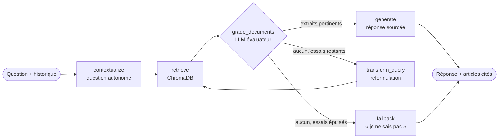

# rgpd-crag-agent

[](https://github.com/GuyMartial24/rgpd-crag-agent/actions/workflows/ci_cd.yml)

Agent **Corrective RAG (CRAG)** bilingue (français / anglais) de questions-réponses sur le
**RGPD**, construit avec
**LangGraph**, **Ollama** (LLM et embeddings 100 % locaux), **ChromaDB** et **FastAPI**,
conteneurisé avec **Docker** et testé en **CI/CD** via GitHub Actions.

## Principe

Un RAG classique génère une réponse à partir des extraits retrouvés, même lorsqu'ils sont hors
sujet. Le CRAG ajoute une étape d'**auto-correction** : chaque extrait est évalué par le LLM, et
si aucun n'est pertinent la requête est **reformulée** avec le vocabulaire du règlement avant
une nouvelle recherche. Après un nombre limité d'essais, l'agent préfère reconnaître qu'il ne
sait pas plutôt que d'halluciner.

L'agent a aussi une **mémoire de conversation** : une question de relance (« et pour les
mineurs ? ») est d'abord réécrite en question autonome à partir des échanges précédents,
pour que la recherche dans le RGPD reste pertinente.



## Structure

```
rgpd-crag-agent/
├── .github/workflows/ci_cd.yml # CI/CD GitHub Actions (lint, tests, build Docker, déploiement)
├── data/
│   ├── RGPD_FR.pdf            # Texte officiel du RGPD en français (JO L 119 du 4.5.2016)
│   └── RGPD_EN.pdf            # Texte officiel du RGPD en anglais
├── src/
│   ├── config.py              # Paramètres (variables d'environnement / .env)
│   ├── ingest.py              # Extraction PDF, découpage par article, indexation ChromaDB
│   ├── graph.py               # Nœuds et flux de décision LangGraph (CRAG)
│   └── main.py                # API REST FastAPI
├── frontend/
│   ├── widget.js              # Chatbot flottant, intégrable sur n'importe quel site
│   ├── index.html             # Page de démonstration intégrant le chatbot
│   ├── page.css
│   ├── nginx.conf             # Sert les fichiers et transmet /api/ au backend
│   └── Dockerfile
├── tests/
│   ├── test_ingest.py         # Extraction des PDF, chunking et accès ChromaDB
│   └── test_agent.py          # Graphe CRAG, API et évaluation de bout en bout
├── Dockerfile                 # Image de l'API
├── docker-compose.yml         # ollama → modèles → ingestion → api → frontend
├── pyproject.toml             # Configuration de ruff (PEP 8) et pytest
└── requirements.txt
```

## Démarrage rapide (Docker)

```bash
docker compose up -d --build
```

Au premier lancement, les modèles Ollama sont téléchargés (`llama3.2:3b` et `bge-m3`, ~3 Go)
puis les deux PDF sont indexés. Ensuite :

- **page de démonstration avec le chatbot** : http://localhost:8080 (bulle en bas à droite)
- **API** : http://localhost:8000 (documentation interactive : http://localhost:8000/docs)

### Intégrer le chatbot sur un site

Le chatbot est un widget autonome ([frontend/widget.js](frontend/widget.js)) : une bulle
flottante qui ouvre une fenêtre de discussion. Pour l'ajouter à n'importe quelle page,
une ligne suffit avant `</body>` :

```html
<script src="http://localhost:8080/widget.js"></script>
```

Options facultatives : `data-language="en"` (langue par défaut), `data-title="..."` (titre
de la fenêtre), `data-api-url="..."` (adresse de l'API, par défaut celle du serveur qui
fournit `widget.js`). Les styles du widget sont isolés dans un Shadow DOM : ils
n'interfèrent pas avec ceux du site hôte.

Les sites autorisés à appeler l'API se règlent avec `CORS_ORIGINS` (tous par défaut).

```bash
curl -X POST http://localhost:8000/ask \
  -H "Content-Type: application/json" \
  -d '{"question": "Dans quel délai faut-il notifier une violation de données ?", "language": "fr"}'
```

```json
{
  "answer": "Le responsable du traitement doit notifier la violation à l'autorité de contrôle dans les meilleurs délais et, si possible, 72 heures au plus tard après en avoir pris connaissance (Article 33)...",
  "sources": ["Article 33", "Article 34"],
  "standalone_question": "Dans quel délai faut-il notifier une violation de données ?",
  "search_query": "Dans quel délai faut-il notifier une violation de données ?",
  "rewrites": 0
}
```

Le champ `language` (`fr` par défaut, ou `en`) choisit la version du règlement interrogée et
la langue de la réponse.

### Mémoire de conversation

L'API ne stocke rien : le client renvoie les échanges précédents dans `history` (20 au
maximum, l'agent utilise les `MAX_HISTORY` plus récents). La réponse indique dans
`standalone_question` comment la relance a été comprise :

```bash
curl -X POST http://localhost:8000/ask \
  -H "Content-Type: application/json" \
  -d '{
    "question": "Et à qui faut-il la signaler ?",
    "history": [
      {"question": "Dans quel délai notifier une violation de données ?",
       "answer": "72 heures au plus tard après en avoir pris connaissance (Article 33)."}
    ]
  }'
```

Le widget gère cet historique automatiquement et le conserve dans le `sessionStorage` du
navigateur : la conversation continue quand le visiteur change de page, et le bouton ↺
démarre une nouvelle conversation.

## Développement local

Prérequis : Python 3.12 et [Ollama](https://ollama.com) installé localement.

```bash
python -m venv venv
source venv/bin/activate          # Windows : venv\Scripts\activate
pip install -r requirements.txt

ollama pull llama3.2:3b
ollama pull bge-m3

python -m src.ingest              # indexe les PDF de data/ dans ./chroma_db
uvicorn src.main:app --reload
```

Après modification des PDF ou des paramètres de découpage : `python -m src.ingest --reset`.

## Configuration

Toutes les valeurs de [src/config.py](src/config.py) sont surchargeables par variable
d'environnement ou fichier `.env` :

| Variable | Défaut | Rôle |
|---|---|---|
| `OLLAMA_BASE_URL` | `http://localhost:11434` | URL du serveur Ollama |
| `LLM_MODEL` | `llama3.2:3b` | Modèle de génération / évaluation |
| `EMBEDDING_MODEL` | `bge-m3` | Modèle d'embeddings (multilingue) |
| `CORPUS_FILES` | `{"fr": "data/RGPD_FR.pdf", "en": "data/RGPD_EN.pdf"}` | PDF à indexer, par langue (JSON) |
| `CHROMA_PATH` | `./chroma_db` | Répertoire de la base vectorielle |
| `CHUNK_SIZE` / `CHUNK_OVERLAP` | `1000` / `150` | Découpage des articles |
| `TOP_K` | `4` | Nombre d'extraits récupérés |
| `MAX_REWRITES` | `2` | Reformulations maximales avant abandon |
| `MAX_HISTORY` | `6` | Échanges passés pris en compte (mémoire de conversation) |
| `CORS_ORIGINS` | `["*"]` | Sites autorisés à appeler l'API (JSON), ex. `["https://mon-site.fr"]` |

## Qualité du code

Le code suit la PEP 8 (lignes de 79 caractères maximum), vérifiée par
[ruff](https://docs.astral.sh/ruff/) avec la configuration de [pyproject.toml](pyproject.toml).
La CI exécute les mêmes commandes :

```bash
ruff check src tests          # lint (style PEP 8, imports, nommage, erreurs courantes)
ruff format src tests         # formatage automatique
ruff format --check src tests # vérification du formatage, sans modifier les fichiers
```

## Tests

```bash
python -m pytest -v
```

Les tests unitaires utilisent un LLM et des embeddings factices : ils s'exécutent sans Ollama,
y compris en CI. L'évaluation de bout en bout (questions de référence → articles attendus)
s'active avec Ollama démarré et le corpus indexé :

```bash
RUN_OLLAMA_TESTS=1 python -m pytest tests/test_agent.py -v
```

## Déploiement continu (VPS)

Chaque fusion sur `main` déclenche, si le lint, les tests et les builds Docker réussissent,
le job `deploy` du [workflow CI/CD](.github/workflows/ci_cd.yml) :

```
push sur main → lint → tests → build Docker → SSH sur le VPS
              → git pull → docker compose up -d --build → vérification de /health
```

Les branches de travail et les pull requests sont testées mais jamais déployées. Les volumes
Docker (modèles Ollama et base ChromaDB) sont conservés d'un déploiement à l'autre.

### Préparation du VPS (une seule fois)

Configuration conseillée : Ubuntu, **8 Go de RAM** minimum (LLM + embeddings sur processeur),
4 vCPU, 30 Go de disque.

1. **Installer Docker** ([documentation officielle](https://docs.docker.com/engine/install/ubuntu/))
   et créer un utilisateur dédié au déploiement :
   ```bash
   sudo adduser deploy
   sudo usermod -aG docker deploy
   ```
2. **Créer une clé SSH dédiée** (sur votre poste), installer la clé publique sur le VPS :
   ```bash
   ssh-keygen -t ed25519 -f deploy_key -N "" -C "github-actions-deploy"
   ssh-copy-id -i deploy_key.pub deploy@IP_DU_VPS
   ```
3. **Cloner le projet et faire le premier lancement** (connecté en `deploy` sur le VPS) :
   ```bash
   git clone https://github.com/GuyMartial24/rgpd-crag-agent.git
   cd rgpd-crag-agent
   docker compose up -d --build   # premier lancement : téléchargement des modèles (~3 Go)
   ```
4. **Pare-feu** : n'ouvrir que SSH et l'interface web.
   ```bash
   sudo ufw allow 22 && sudo ufw allow 8080 && sudo ufw enable
   ```
   Ollama (11434) et l'API (8000) n'écoutent que sur `127.0.0.1` : ils ne sont pas
   accessibles depuis Internet, l'interface web transmet les appels `/api/` à l'API.
5. **Ajouter les secrets** dans GitHub (*Settings → Secrets and variables → Actions*) :

   | Secret | Valeur |
   |---|---|
   | `VPS_HOST` | adresse IP publique du VPS |
   | `VPS_USERNAME` | `deploy` |
   | `VPS_SSH_KEY` | contenu du fichier `deploy_key` (clé **privée**) |
   | `VPS_PORT` | `22` |
   | `VPS_APP_DIR` | `/home/deploy/rgpd-crag-agent` |

Pour une mise en ligne publique, ajouter ensuite un nom de domaine et HTTPS (par exemple avec
un reverse proxy Caddy devant le port 8080) et restreindre `CORS_ORIGINS` aux sites autorisés.

## Corpus

Le corpus est constitué des PDF officiels du règlement (UE) 2016/679 publiés au
[Journal officiel](https://eur-lex.europa.eu/eli/reg/2016/679/oj), en français et en anglais.
L'ingestion ([src/ingest.py](src/ingest.py)) :

1. extrait le texte avec `pypdf` en retirant pieds de page et notes de bas de page ;
2. découpe les **173 considérants** et les **99 articles**, sans les intitulés de chapitre et de section ;
3. découpe les sections longues en chunks qui rappellent leur article d'origine ;
4. indexe le tout dans une collection ChromaDB unique, avec la langue en métadonnée (`lang`).

> Cet outil fournit une aide à la lecture du RGPD et ne constitue pas un conseil juridique.
