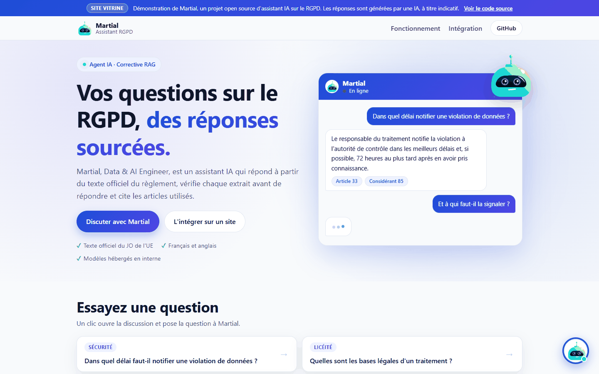
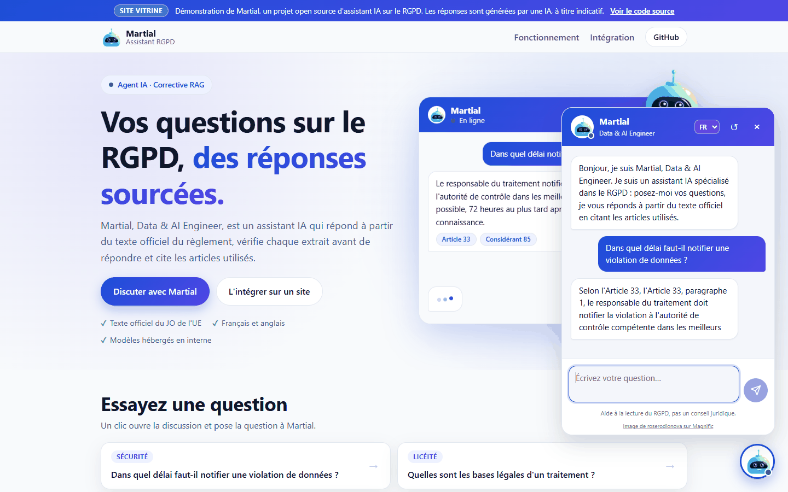
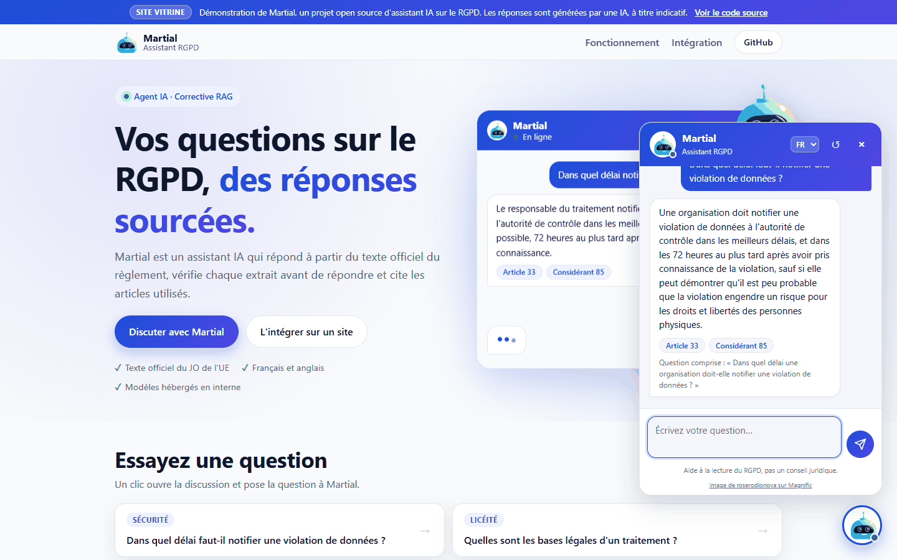
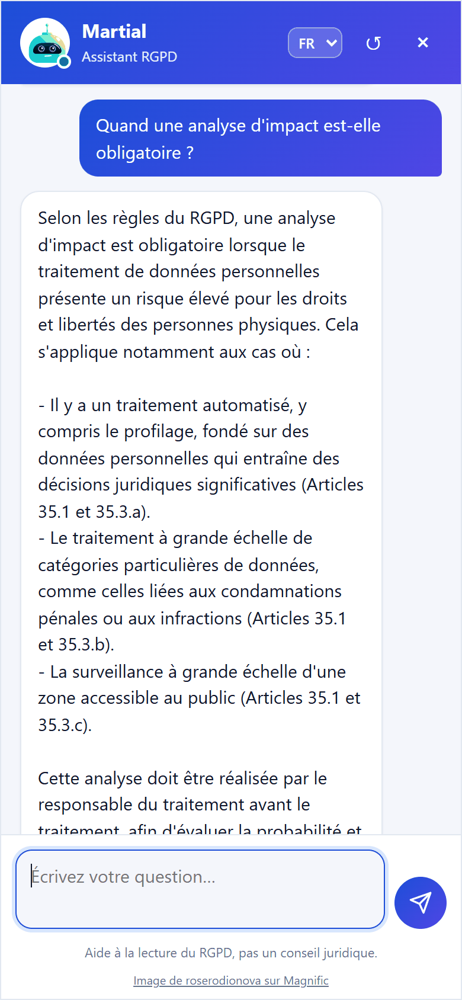
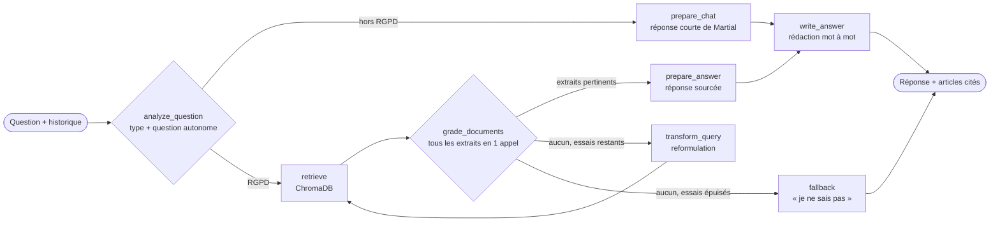
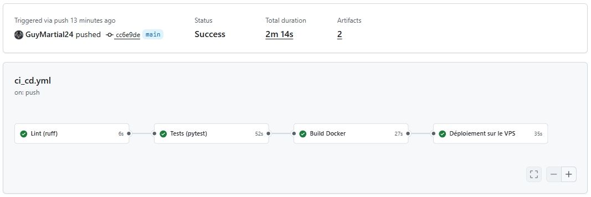
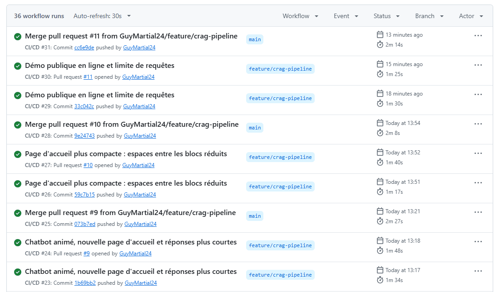

# RGPD-CRAG-AGENT

[](https://github.com/GuyMartial24/rgpd-crag-agent/actions/workflows/ci_cd.yml)

**[Essayer la démo en ligne → martial-rgpd.duckdns.org](https://martial-rgpd.duckdns.org)**
(serveur sans carte graphique : comptez 30 à 60 secondes par réponse, les questions sont
traitées une par une)

**Auteur : Martial GADJEU | Data & AI Engineer** ([GitHub](https://github.com/GuyMartial24))

**Martial**, assistant IA bilingue (français / anglais) de questions-réponses sur le **RGPD**.
Un agent **Corrective RAG (CRAG)** construit avec **LangGraph**, **Ollama** (LLM et
embeddings 100 % locaux), **ChromaDB** et **FastAPI**, avec un chatbot web intégrable sur
n'importe quel site, conteneurisé avec **Docker** et déployé en **CI/CD** sur un VPS via
GitHub Actions.

## Aperçu

Le site vitrine de démonstration, avec le chatbot en bas à droite :



| La réponse s'écrit au fil de la rédaction (*streaming*) | Réponse complète, avec les articles cités |
|---|---|
|  |  |

<p align="center">
  
  <br>
  <em>Sur mobile, la discussion occupe tout l'écran.</em>
</p>

## Principe

Un RAG classique génère une réponse à partir des extraits retrouvés, même lorsqu'ils sont hors
sujet. Le CRAG ajoute une étape d'**auto-correction** : chaque extrait est évalué par le LLM, et
si aucun n'est pertinent la requête est **reformulée** avec le vocabulaire du règlement avant
une nouvelle recherche. Après un nombre limité d'essais, l'agent préfère reconnaître qu'il ne
sait pas plutôt que d'halluciner.

L'agent a aussi une **mémoire de conversation** : une question de relance (« et pour les
mineurs ? ») est d'abord réécrite en question autonome à partir des échanges précédents,
pour que la recherche dans le RGPD reste pertinente.



La rédaction (`write_answer`) a lieu après le graphe : la réponse est envoyée au navigateur
**au fil de son écriture** (*streaming*), et l'étape en cours (« Recherche dans le RGPD… »,
« Rédaction de la réponse… ») s'affiche pendant l'attente.

Pour limiter le temps de réponse, une question RGPD ne demande que **3 appels au LLM** :
l'analyse (qui détecte aussi les messages hors sujet comme « bonjour » ou « qui es-tu ? »),
l'évaluation groupée des extraits, puis la rédaction. Les messages hors RGPD reçoivent une
réponse directe en 2 appels, sans recherche.

Avant chaque recherche, un **glossaire** ([src/vocabulary.py](src/vocabulary.py)) complète la
requête avec les termes du règlement : les utilisateurs parlent de « bases légales », de
« droit à l'oubli » ou de « fuite de données », alors que le texte dit « licéité du
traitement », « droit à l'effacement » et « violation de données à caractère personnel ».
Sans appel supplémentaire au LLM, l'article attendu remonte bien plus souvent dans les
premiers résultats (par exemple l'Article 6 pour les bases légales).

### Martial, l'assistant

L'assistant se présente sous le nom de **Martial, Data & AI Engineer** : un ton clair,
pédagogique et professionnel, qui vouvoie et cite systématiquement les articles utilisés.
Il annonce toujours être un **assistant IA**, conformément à l'obligation de transparence de
l'AI Act européen. Le nom et le titre se règlent avec `ASSISTANT_NAME` et `ASSISTANT_ROLE`.

## Structure

```
rgpd-crag-agent/
├── .github/workflows/ci_cd.yml # CI/CD GitHub Actions (lint, tests, build Docker, déploiement)
├── data/
│   ├── RGPD_FR.pdf            # Texte officiel du RGPD en français (JO L 119 du 4.5.2016)
│   ├── RGPD_EN.pdf            # Texte officiel du RGPD en anglais
│   └── chroma_db.tar.gz       # Base ChromaDB déjà calculée (bge-m3, 1 081 chunks, 11 Mo)
├── src/
│   ├── config.py              # Paramètres (variables d'environnement / .env)
│   ├── ingest.py              # Extraction PDF, découpage par article, indexation ChromaDB
│   ├── graph.py               # Nœuds et flux de décision LangGraph (CRAG), personnalité
│   ├── vocabulary.py          # Glossaire : vocabulaire courant -> termes du RGPD
│   └── main.py                # API REST FastAPI
├── frontend/
│   ├── widget.js              # Chatbot flottant, intégrable sur n'importe quel site
│   ├── bot-avatar.png         # Image de l'assistant (voir Crédits)
│   ├── index.html             # Page de démonstration intégrant le chatbot
│   ├── page.css / page.js     # Styles et interactions de la page de démonstration
│   ├── nginx.conf             # Sert les fichiers et transmet /api/ au backend
│   └── Dockerfile
├── docs/images/               # Captures d'écran utilisées dans ce README
├── tests/
│   ├── test_ingest.py         # Extraction des PDF, chunking, ingestion reprenable, base fournie
│   ├── test_agent.py          # Graphe CRAG, mémoire, personnalité, API, évaluation
│   └── test_vocabulary.py     # Glossaire
├── Dockerfile                 # Image de l'API
├── docker-compose.yml         # Local : ollama → modèles → ingestion → api → frontend
├── docker-compose.vps.yml     # Production : Ollama dédié et prioritaire sur le processeur
├── .env.example               # Variables d'environnement facultatives (à copier en .env)
├── pyproject.toml             # Configuration de ruff (PEP 8) et pytest
├── requirements.txt
└── LICENSE                    # Licence MIT
```

## Démarrage rapide (Docker, en local)

```bash
docker compose up -d --build
```

Au premier lancement, les modèles Ollama sont téléchargés (`qwen2.5:3b` et `bge-m3`, ~3 Go),
puis la **base vectorielle fournie** ([data/chroma_db.tar.gz](data/chroma_db.tar.gz)) est
décompressée en quelques secondes : inutile de recalculer les embeddings, qui prennent environ
35 minutes sur un processeur sans carte graphique. Ensuite :

- **page de démonstration avec le chatbot** : http://localhost:8080 (bulle en bas à droite)
- **API** : http://localhost:8000 (documentation interactive : http://localhost:8000/docs)

### Intégrer le chatbot sur un site

Le chatbot est un widget autonome ([frontend/widget.js](frontend/widget.js)) : une bulle
flottante qui ouvre une fenêtre de discussion avec Martial. Pour l'ajouter à n'importe quelle
page, une ligne suffit avant `</body>` :

```html
<script src="http://localhost:8080/widget.js"></script>
```

Options facultatives (attributs de la balise `<script>`) :

| Attribut | Défaut | Rôle |
|---|---|---|
| `data-language` | `fr` | Langue par défaut (`fr` ou `en`) |
| `data-title` | `Martial` | Nom de l'assistant affiché dans l'en-tête |
| `data-role` | `Data & AI Engineer` | Titre affiché sous le nom |
| `data-avatar` | `bot-avatar.png` à côté de `widget.js` | Image de l'assistant |
| `data-api-url` | serveur qui fournit `widget.js` + `/api` | Adresse de l'API |

Les styles du widget sont isolés dans un Shadow DOM : ils n'interfèrent pas avec ceux du site
hôte. Les sites autorisés à appeler l'API se règlent avec `CORS_ORIGINS` (tous par défaut).

La page hôte peut aussi piloter le chatbot en JavaScript, par exemple depuis un bouton
« Discuter avec Martial » ou une question d'exemple :

```js
window.RgpdChatWidget.open();                      // ouvre la discussion
window.RgpdChatWidget.ask("Qu'est-ce qu'un DPO ?"); // ouvre et pose la question
```

Le widget est animé (bulle flottante, robot qui salue, bulle d'invitation, avatar qui
« réfléchit » pendant l'attente), propose des questions d'exemple et suit le thème clair ou
sombre du système. Les animations sont désactivées si l'utilisateur a demandé à son système
de les réduire. Aucune police ni ressource externe n'est chargée.

### API

```bash
curl -X POST http://localhost:8000/ask \
  -H "Content-Type: application/json" \
  -d '{"question": "Dans quel délai faut-il notifier une violation de données ?", "language": "fr"}'
```

```json
{
  "answer": "Le responsable du traitement doit notifier la violation à l'autorité de contrôle dans les meilleurs délais et, si possible, 72 heures au plus tard après en avoir pris connaissance (Article 33)...",
  "sources": ["Article 33", "Article 34"],
  "standalone_question": "Dans quel délai faut-il notifier une violation de données ?",
  "search_query": "Dans quel délai faut-il notifier une violation de données ?",
  "rewrites": 0
}
```

Le champ `language` (`fr` par défaut, ou `en`) choisit la version du règlement interrogée et
la langue de la réponse. Codes d'erreur : `422` question invalide, `503` Ollama indisponible,
`504` modèle trop lent (délai `REQUEST_TIMEOUT` dépassé).

**Streaming** : `POST /ask/stream` accepte le même corps et renvoie la réponse au fil de sa
rédaction, au format [NDJSON](https://github.com/ndjson/ndjson-spec) (une ligne JSON par
événement). C'est la route utilisée par le widget :

```bash
curl -N -X POST http://localhost:8000/ask/stream   -H "Content-Type: application/json"   -d '{"question": "Dans quel délai faut-il notifier une violation de données ?"}'
```

```
{"type": "status", "step": "search"}
{"type": "status", "step": "grade"}
{"type": "status", "step": "write"}
{"type": "token", "text": "Le responsable"}
{"type": "token", "text": " du traitement"}
...
{"type": "done", "answer": "...", "sources": ["Article 33"], "standalone_question": "...", "search_query": "...", "rewrites": 0}
```

Le code HTTP `200` étant envoyé avant la réponse, une erreur d'Ollama arrive sous la forme
d'un dernier événement `{"type": "error", "status": 504, "detail": "..."}` (ou `503`).

### Mémoire de conversation

L'API ne stocke rien : le client renvoie les échanges précédents dans `history` (20 au
maximum, l'agent utilise les `MAX_HISTORY` plus récents). La réponse indique dans
`standalone_question` comment la relance a été comprise :

```bash
curl -X POST http://localhost:8000/ask \
  -H "Content-Type: application/json" \
  -d '{
    "question": "Et à qui faut-il la signaler ?",
    "history": [
      {"question": "Dans quel délai notifier une violation de données ?",
       "answer": "72 heures au plus tard après en avoir pris connaissance (Article 33)."}
    ]
  }'
```

Le widget gère cet historique automatiquement et le conserve dans le `sessionStorage` du
navigateur : la conversation continue quand le visiteur change de page, et le bouton ↺
démarre une nouvelle conversation.

## Développement local (sans Docker)

Prérequis : Python 3.12 et [Ollama](https://ollama.com) installé localement.

```bash
python -m venv venv
source venv/bin/activate          # Windows : venv\Scripts\activate
pip install -r requirements.txt

ollama pull qwen2.5:3b
ollama pull bge-m3

python -m src.ingest              # décompresse la base fournie dans ./chroma_db
uvicorn src.main:app --reload
```

## Configuration

Toutes les valeurs de [src/config.py](src/config.py) sont surchargeables par variable
d'environnement ou fichier `.env` :

| Variable | Défaut | Rôle |
|---|---|---|
| `OLLAMA_BASE_URL` | `http://localhost:11434` | URL du serveur Ollama |
| `LLM_MODEL` | `qwen2.5:3b` | Modèle de génération / évaluation |
| `EMBEDDING_MODEL` | `bge-m3` | Modèle d'embeddings (multilingue) |
| `REQUEST_TIMEOUT` | `120` | Délai maximal d'un appel à Ollama (secondes) |
| `MAX_ANSWER_TOKENS` | `600` | Longueur maximale d'une réponse (tokens) |
| `OLLAMA_KEEP_ALIVE` | `30m` | Durée de maintien du modèle en mémoire après un appel |
| `CORPUS_FILES` | `{"fr": "data/RGPD_FR.pdf", "en": "data/RGPD_EN.pdf"}` | PDF à indexer, par langue (JSON) |
| `CHROMA_PATH` | `./chroma_db` | Répertoire de la base vectorielle |
| `CHUNK_SIZE` / `CHUNK_OVERLAP` | `1000` / `150` | Découpage des articles |
| `TOP_K` | `3` | Nombre d'extraits récupérés |
| `MAX_REWRITES` | `1` | Reformulations maximales avant abandon |
| `MAX_HISTORY` | `4` | Échanges passés pris en compte (mémoire de conversation) |
| `GRADE_EXCERPT_LENGTH` | `400` | Longueur des extraits montrés au LLM pour l'évaluation (caractères) |
| `ASSISTANT_NAME` / `ASSISTANT_ROLE` | `Martial` / `Data & AI Engineer` | Personnalité de l'assistant |
| `CORS_ORIGINS` | `["*"]` | Sites autorisés à appeler l'API (JSON), ex. `["https://mon-site.fr"]` |

## Corpus et indexation

Le corpus est constitué des PDF officiels du règlement (UE) 2016/679 publiés au
[Journal officiel](https://eur-lex.europa.eu/eli/reg/2016/679/oj), en français et en anglais.
L'ingestion ([src/ingest.py](src/ingest.py)) :

1. extrait le texte avec `pypdf` en retirant pieds de page et notes de bas de page ;
2. découpe les **173 considérants** et les **99 articles**, sans les intitulés de chapitre et de section ;
3. découpe les sections longues en chunks qui rappellent leur article d'origine ;
4. indexe le tout dans une collection ChromaDB unique, avec la langue en métadonnée (`lang`).

L'ingestion est **reprenable** : seuls les chunks absents de la base sont calculés. Une
indexation interrompue reprend là où elle s'était arrêtée, et une base complète est ignorée
en quelques secondes. Le modèle d'embedding est enregistré avec la base : en cas de
changement de `EMBEDDING_MODEL`, l'ingestion s'arrête et demande de reconstruire la base :

```bash
python -m src.ingest --reset
```

### Base fournie avec le projet

Le dépôt contient la base déjà calculée, [data/chroma_db.tar.gz](data/chroma_db.tar.gz)
(`bge-m3`, 1 081 chunks, 11 Mo). Au premier lancement, l'ingestion la décompresse si :

- la base locale est **vide** (une base existante n'est jamais écrasée) ;
- `EMBEDDING_MODEL` vaut `bge-m3` (avec un autre modèle, les vecteurs ne seraient pas
  comparables : tout est alors recalculé).

Le test `test_provided_index_is_complete_and_up_to_date` vérifie dans la CI que l'archive
correspond exactement au découpage actuel. Après une modification du découpage (ou des
paramètres `CHUNK_SIZE` / `CHUNK_OVERLAP`), régénérez-la puis commitez-la :

```bash
python -m src.ingest --reset     # recalcule toute la base (~35 min sans GPU)
python -m src.ingest --export    # enregistre la base dans data/chroma_db.tar.gz
```

## Qualité du code

Le code suit la PEP 8 (lignes de 79 caractères maximum), vérifiée par
[ruff](https://docs.astral.sh/ruff/) avec la configuration de [pyproject.toml](pyproject.toml).
La CI exécute les mêmes commandes :

```bash
ruff check src tests          # lint (style PEP 8, imports, nommage, erreurs courantes)
ruff format src tests         # formatage automatique
ruff format --check src tests # vérification du formatage, sans modifier les fichiers
```

## Tests

```bash
python -m pytest -v
```

Les tests unitaires utilisent un LLM et des embeddings factices : ils s'exécutent sans Ollama,
y compris en CI. L'évaluation de bout en bout (questions de référence → articles attendus)
s'active avec Ollama démarré et le corpus indexé :

```bash
RUN_OLLAMA_TESTS=1 python -m pytest tests/test_agent.py -v
```

## Déploiement continu (VPS)

Chaque fusion sur `main` déclenche le job `deploy` du
[workflow CI/CD](.github/workflows/ci_cd.yml), uniquement si le lint, les tests et les builds
Docker réussissent :

```
push sur main → lint → tests → build Docker → SSH sur le VPS
              → git pull → docker compose up -d --build → vérification de /health
```

Les branches de travail et les pull requests sont testées mais jamais déployées. Le
déploiement peut aussi être relancé à la main depuis l'onglet *Actions* (*Run workflow* sur
`main`). La base ChromaDB est conservée d'un déploiement à l'autre (volume Docker), et
l'ingestion reprenable ne recalcule rien si elle est déjà complète.

Une exécution sur `main` : les quatre jobs s'enchaînent, le déploiement n'a lieu que si tous
les précédents réussissent.



L'historique des exécutions : chaque push sur la branche de travail et chaque pull request
est testé (lint, tests, build), seules les fusions sur `main` sont déployées.



### Architecture en production

Sur le VPS, [docker-compose.vps.yml](docker-compose.vps.yml) complète `docker-compose.yml`.
Le serveur fait aussi tourner d'autres applications, qui utilisent l'Ollama installé
directement sur la machine. Le projet garde donc **son propre Ollama dans Docker, avec une
priorité processeur maximale** (`cpu_shares`) :

- quand l'assistant calcule une réponse, il obtient presque tout le processeur et les autres
  applications patientent ;
- dès qu'il a fini, il ne consomme plus rien et les autres applications récupèrent tout le
  processeur.

Modèles utilisés : `qwen2.5:3b` pour les réponses (léger et bon en français), `bge-m3` pour
les embeddings. Ils sont téléchargés automatiquement par le service `ollama-pull`.

```
Navigateur ──► frontend (nginx, :8080) ──/api/──► api (FastAPI, 127.0.0.1:8000)
                                                    │
                                                    ├─► ChromaDB (volume Docker)
                                                    └─► ollama (Docker, prioritaire)
```

Seule l'interface web (port 8080) est publiée ; l'API et Ollama ne sont pas accessibles depuis
Internet (l'Ollama du projet n'est joignable que par le réseau interne de Docker).

### Préparation du VPS (une seule fois)

Configuration utilisée : Ubuntu 24.04 ARM (Oracle Cloud), 4 cœurs, 24 Go de RAM, sans carte
graphique. Comptez environ **4 Go de RAM disponibles** pour `qwen2.5:3b` + `bge-m3`, et
prévoyez un fichier d'échange (*swap*) si la mémoire est partagée avec d'autres applications :

```bash
sudo fallocate -l 8G /swapfile && sudo chmod 600 /swapfile
sudo mkswap /swapfile && sudo swapon /swapfile
echo '/swapfile none swap sw 0 0' | sudo tee -a /etc/fstab
```

1. **Docker** ([documentation officielle](https://docs.docker.com/engine/install/ubuntu/)) :
   l'utilisateur de déploiement doit appartenir au groupe `docker` (`groups` pour vérifier,
   sinon `sudo usermod -aG docker $USER` puis reconnexion).

2. **Clé SSH dédiée au déploiement**, générée sur votre poste puis autorisée sur le VPS :
   ```bash
   ssh-keygen -t ed25519 -f deploy_key -N "" -C "github-actions-deploy"
   ```
   Ajouter le contenu de `deploy_key.pub` à `~/.ssh/authorized_keys` sur le VPS
   (`chmod 700 ~/.ssh && chmod 600 ~/.ssh/authorized_keys`). Sous Windows, `ssh-copy-id`
   n'existe pas : copier la ligne à la main.

3. **Cloner le projet et faire le premier lancement** :
   ```bash
   mkdir -p ~/Projets_en_Production && cd ~/Projets_en_Production
   git clone https://github.com/GuyMartial24/rgpd-crag-agent.git
   cd rgpd-crag-agent
   echo "COMPOSE_FILE=docker-compose.yml:docker-compose.vps.yml" > .env
   docker compose up -d --build
   docker logs -f rgpd-crag-agent-ingest-1     # suivi de l'indexation
   ```
   Le premier lancement télécharge les modèles (~3 Go), puis décompresse la base fournie
   en quelques secondes (sans elle, le calcul des 1 081 chunks avec `bge-m3` sur processeur
   ARM prend environ 35 minutes). Le fichier `.env` (ignoré par git)
   peut aussi surcharger `LLM_MODEL`.

4. **Secrets GitHub** (*Settings → Secrets and variables → Actions*) :

   | Secret | Valeur |
   |---|---|
   | `VPS_HOST` | adresse IP publique du VPS |
   | `VPS_USERNAME` | utilisateur SSH (ex. `ubuntu`) |
   | `VPS_SSH_KEY` | contenu du fichier `deploy_key` (clé **privée**, lignes `BEGIN`/`END` comprises) |
   | `VPS_PORT` | `22` |
   | `VPS_APP_DIR` | chemin affiché par `pwd` dans le dossier du projet, ex. `/home/ubuntu/Projets_en_Production/rgpd-crag-agent` |

### Accéder au chatbot

La démo publique est en ligne sur **https://martial-rgpd.duckdns.org** :

```
Internet ──HTTPS──► Caddy (reverse proxy déjà présent sur le serveur, certificat
                    Let's Encrypt automatique) ──► frontend (nginx, :8080) ──► api
```

- **Nom de domaine** : sous-domaine gratuit [DuckDNS](https://www.duckdns.org) pointant
  vers l'IP du VPS. Le port 8080 reste fermé dans le pare-feu de l'hébergeur : seul Caddy
  (ports 80 et 443) est exposé.
- **Caddy** : un bloc suffit, `flush_interval -1` transmet le *streaming* sans attendre la
  fin de la réponse :
  ```
  martial-rgpd.duckdns.org {
      reverse_proxy <IP privée du serveur>:8080 {
          flush_interval -1
      }
  }
  ```
- **Protection** ([frontend/nginx.conf](frontend/nginx.conf)) : le serveur traite une seule
  question à la fois, l'API est donc limitée à 6 questions par minute (7 d'affilée au
  maximum) et à 4 questions en cours, tous visiteurs confondus. Au-delà, nginx répond `429`
  et le widget invite à réessayer dans une minute.

Sans domaine, l'accès reste possible par un **tunnel SSH** depuis son poste :

```bash
ssh -L 8081:127.0.0.1:8080 utilisateur@IP_DU_VPS
```

puis http://localhost:8081 dans le navigateur, tant que la session SSH reste ouverte.

## Limites connues

- **Temps de réponse** : sur processeur, même avec 3 appels au LLM par question, la
  rédaction de la réponse reste l'étape la plus longue. Les logs de l'API
  (`docker compose logs -f api`) indiquent la durée de chaque étape et de chaque appel à
  Ollama. Grâce au *streaming*, le texte commence à s'afficher dès que la rédaction démarre.
  Un modèle plus gros (`qwen2.5:7b`, `llama3.1`) donne des réponses plus riches, mais
  nettement plus lentes.
- **Aiguillage** : un message ambigu est traité comme une question RGPD (choix le plus sûr),
  ce qui peut déclencher une recherche inutile.

## Auteur

**Martial GADJEU | Data & AI Engineer** — conception, développement et déploiement du
projet ([GitHub](https://github.com/GuyMartial24)).

## Licence

Le code est publié sous [licence MIT](LICENSE). Deux éléments du dépôt relèvent de leur
propre licence :

- le texte officiel du RGPD ([data/](data/)), document de l'Union européenne dont la
  réutilisation est autorisée avec mention de la source ;
- l'image de l'assistant ([frontend/bot-avatar.png](frontend/bot-avatar.png)), utilisée selon
  la licence gratuite de Magnific (attribution obligatoire, voir ci-dessous).

## Crédits

- Texte du RGPD : [Journal officiel de l'Union européenne](https://eur-lex.europa.eu/eli/reg/2016/679/oj).
- Image de l'assistant ([frontend/bot-avatar.png](frontend/bot-avatar.png), recadrée) :
  [Image de roserodionova sur Magnific](https://www.magnific.com/fr/vecteurs-libre/bot-mignon-dire-aux-utilisateurs-bonjour-chatbot-salue-consultation-ligne_4015765.htm),
  licence gratuite avec attribution.

> Cet outil fournit une aide à la lecture du RGPD et ne constitue pas un conseil juridique.
